# Nuvela Hair Clinic

A full-stack, multilingual website for a (fictional) hair transplant clinic in Istanbul, Turkey.

**Live demo:** https://aisignalneuro.github.io/nuvela-hair-clinic/

**Designed & developed by [Renix.dev](https://renix.dev/en)** · [LinkedIn](https://www.linkedin.com/company/renix-dev/)

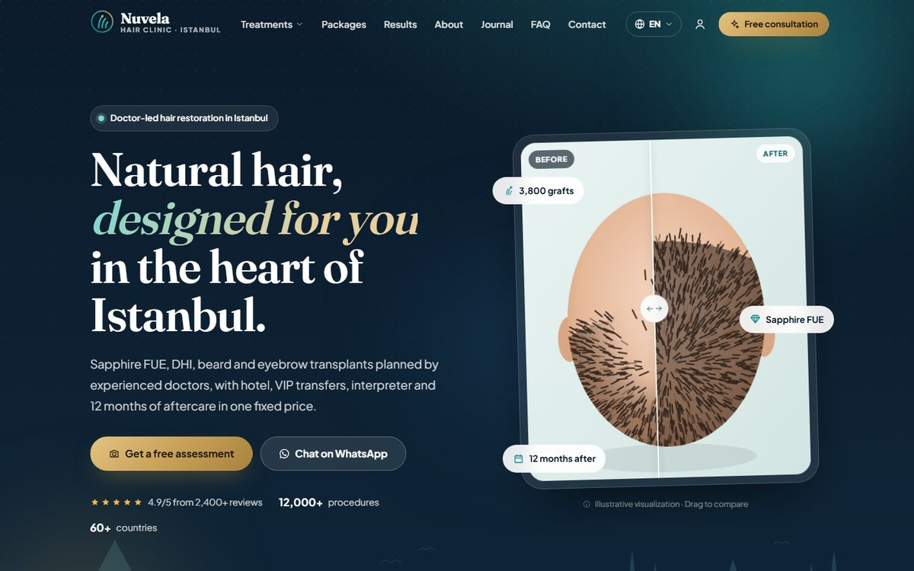

**Contents:** [UI / UX & visual design](#ui--ux--visual-design) · [Database](#database) · [Features](#features) · [Project structure](#project-structure) · [Getting started](#getting-started) · [API](#api-overview) · [Deployment](#deployment) · [Credits](#credits)

| | |
|---|---|
| **Languages** | English, Türkçe, العربية (full RTL) |
| **Frontend** | React 19, Vite 7, React Router 7, Framer Motion |
| **Backend** | Node.js, Express, Prisma ORM, PostgreSQL |
| **Auth** | Phone OTP, Google Sign-In, staff email/password, JWT + rotating refresh tokens |
| **Hosting** | Frontend on GitHub Pages (static), API via Docker on any Node host |

> Nuvela, its doctors, reviews, prices and contact details are fictional and exist only for this portfolio project.

---

## UI / UX & visual design

### Design goals

| Goal | How the interface answers it |
|---|---|
| **Trust before price** | Doctor-led messaging, licensing and guarantee badges, real recovery timelines, transparent package comparison and a visible demo/medical disclaimer |
| **One clear next step** | Every page ends in a single primary action (free assessment) with WhatsApp as the secondary path; a floating contact dock stays one tap away |
| **International patients** | Three languages with a native RTL layout for Arabic, localized prices, dates and country names via `Intl`, and travel-focused content (airports, hotel, interpreter) |
| **Calm, premium feel** | Deep navy + Istanbul turquoise with a warm gold accent, generous whitespace, glass panels and an illustrated skyline instead of stock photos |
| **Privacy by design** | Before/after results are SVG illustrations drawn from each case's data, so no patient photo is ever published |
| **Fast on phones** | Mobile-first layouts, code-split routes, lazy locale bundles, no image payload for illustrations |

### Design system

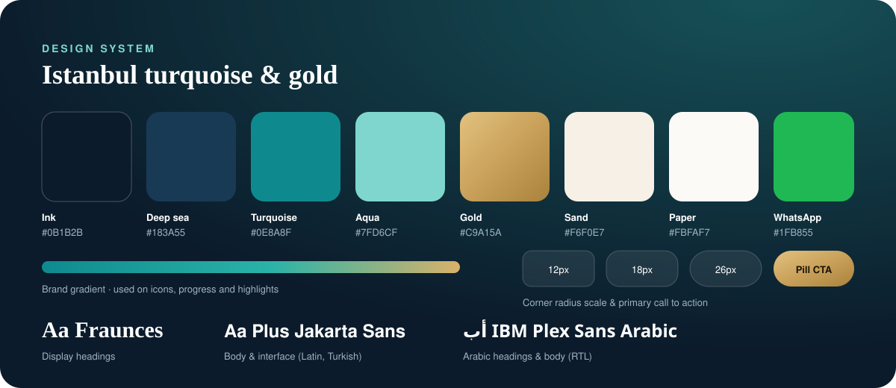

- **Tokens** live in [`frontend/src/styles/tokens.css`](frontend/src/styles/tokens.css): colors, gradients, radii (12 / 18 / 26 / 34 px), elevation and spacing.
- **Typography:** Fraunces for display headings, Plus Jakarta Sans for interface text (full Turkish support), IBM Plex Sans Arabic for RTL pages.
- **Components:** buttons (primary, gold, glass, ghost, WhatsApp), chips, badges, cards (service, case, package, journal, doctor), accordion, modal, drawer, toasts, before/after slider, breadcrumbs, language switcher.
- **Iconography:** a hand-made 24 px line icon set; directional icons mirror automatically in RTL.
- **Illustration:** an Istanbul skyline (Galata Tower, Bosphorus Bridge, mosque silhouettes), Iznik-inspired cover patterns for journal posts and the procedural scalp/beard/brow artwork.
- **Motion:** shared Framer Motion variants for scroll reveals, staggered grids, floating cards, spring modals and page transitions; `prefers-reduced-motion` turns them off.

### Screens

| Home & treatments | Treatment detail |
|---|---|
| 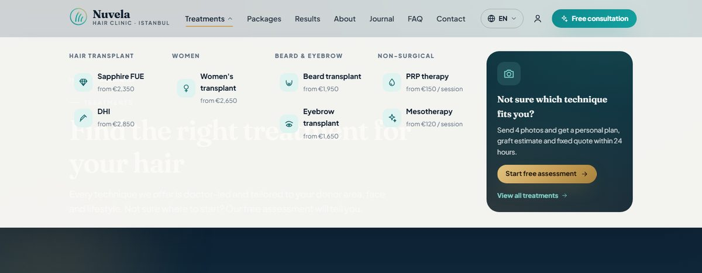 | 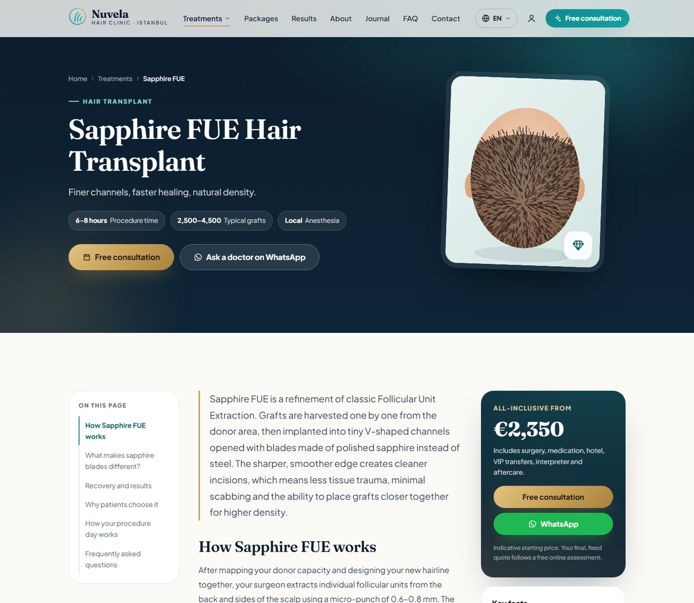 |
| **Before / after gallery** | **Packages & comparison** |
| 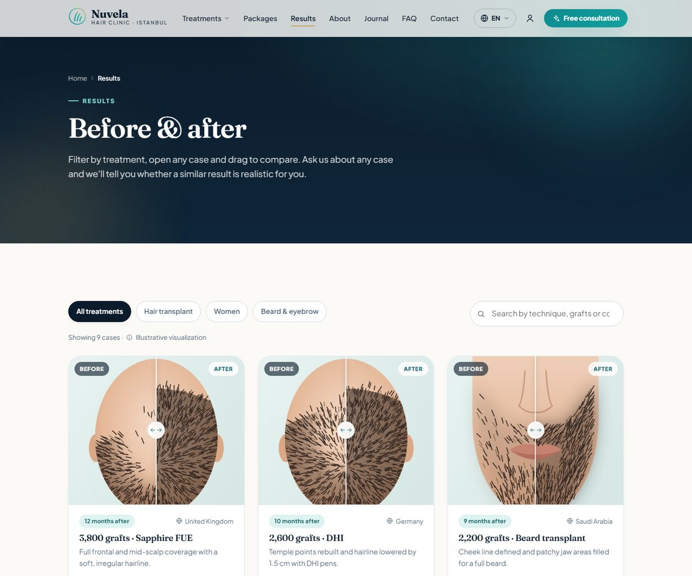 | 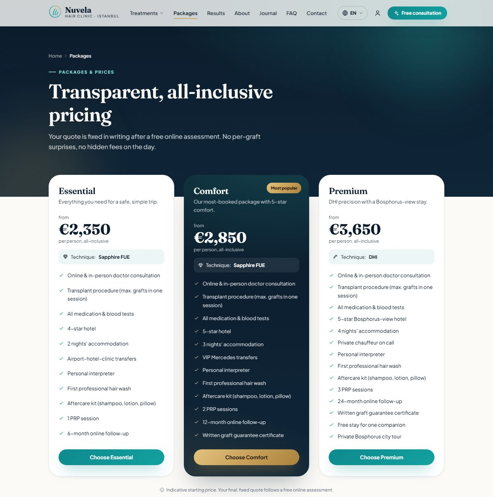 |
| **Consultation wizard** | **Journal article** |
| 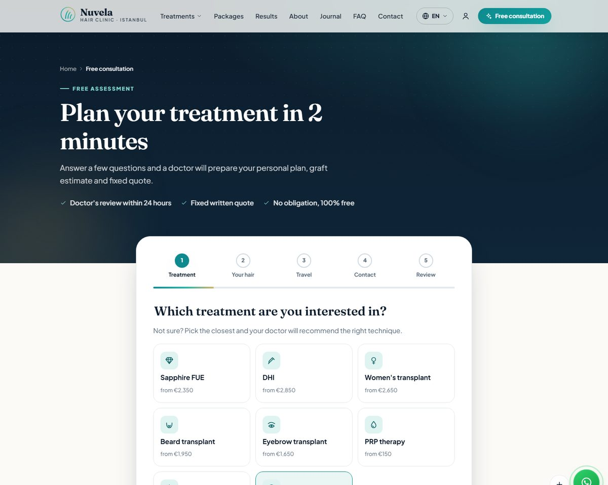 | 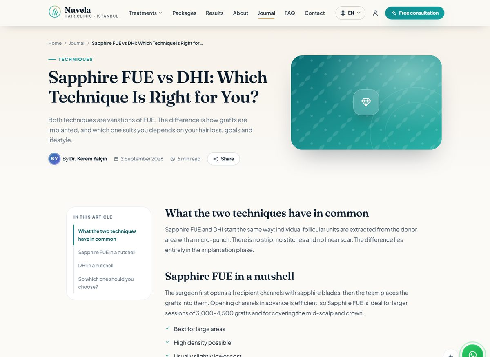 |
| **Arabic (RTL)** | **Turkish** |
| 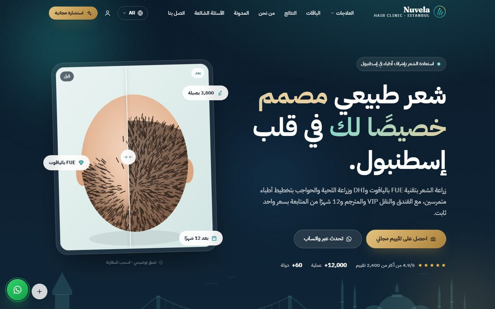 | 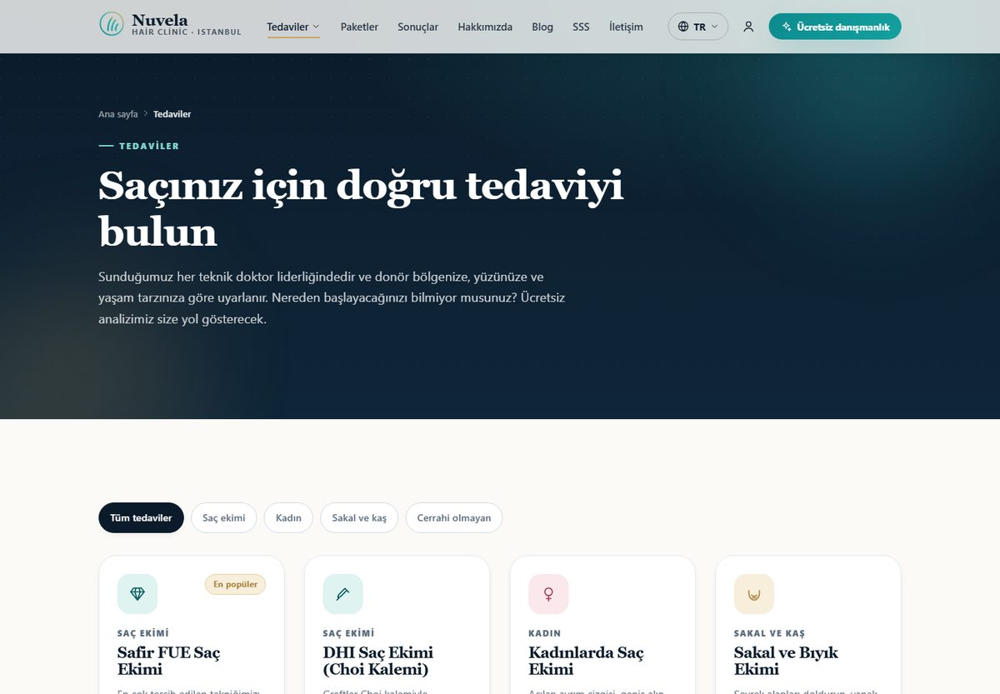 |

**Mobile** (home, Arabic treatment page, case details, Turkish booking wizard, navigation drawer):

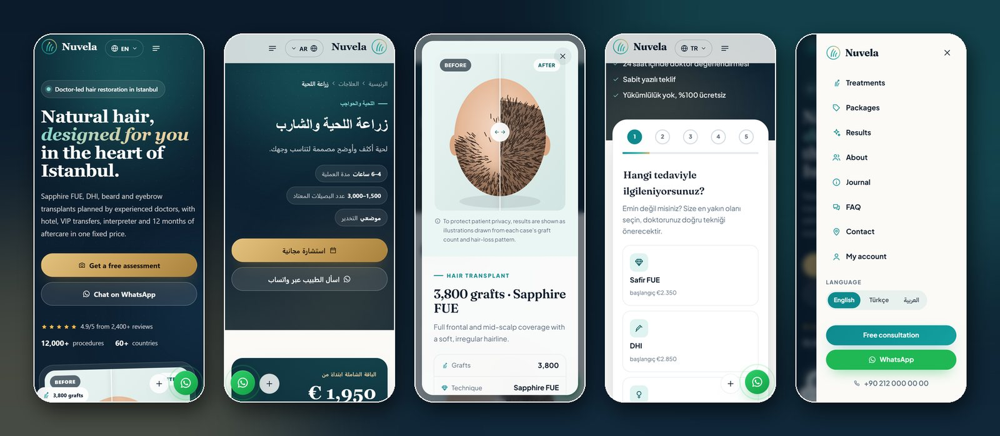

<details>
<summary>Full home page</summary>

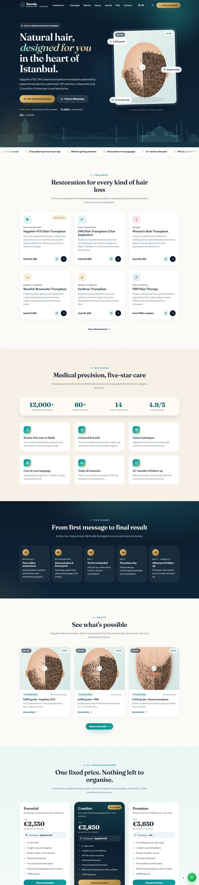

</details>

### UX details

- **Navigation:** sticky header that turns from transparent to frosted glass on scroll, a treatments mega menu grouped by category with prices, and a full-height mobile drawer with the language switcher.
- **Conversion paths:** quick booking modal (opens pre-filled with the treatment you came from), a 5-step wizard with progress, inline validation and an editable summary, plus WhatsApp deep links with a pre-written message and the booking reference.
- **Content structure:** treatment pages follow a fixed pattern (intro, how it works, benefits vs. candidates, procedure steps, FAQ) with a sticky table of contents and a sticky price card; articles add a reading-progress bar, author card and related posts.
- **Accessibility:** semantic landmarks, skip link, visible focus rings, `aria` states on menus, tabs and accordions, focus moved into and restored from dialogs, Escape to close, keyboard-operable before/after slider.
- **States:** loading, empty search results, form errors, success screens with a reference number, and a clear demo-mode notice when no backend is connected.

---

## Database

PostgreSQL schema managed with Prisma ([`backend/prisma/schema.prisma`](backend/prisma/schema.prisma)). Content tables keep language-neutral fields (slug, price, ordering, flags) and store copy in a `*_translations` table with one row per locale; the API returns the requested locale and falls back to English.

```mermaid
erDiagram
    USER ||--o{ APPOINTMENT : "books"
    USER ||--o{ REFRESH_TOKEN : "signs in with"
    USER ||--o{ MEDIA : "uploads"
    SERVICE ||--o{ SERVICE_TRANSLATION : "translated as"
    SERVICE ||--o{ GALLERY_CASE : "showcased in"
    SERVICE ||--o{ APPOINTMENT : "requested for"
    GALLERY_CASE ||--o{ GALLERY_CASE_TRANSLATION : "translated as"
    TEAM_MEMBER ||--o{ TEAM_MEMBER_TRANSLATION : "translated as"
    TEAM_MEMBER ||--o{ BLOG_POST : "writes"
    BLOG_POST ||--o{ BLOG_POST_TRANSLATION : "translated as"
    PACKAGE ||--o{ PACKAGE_TRANSLATION : "translated as"

    USER {
        uuid id PK
        string phone UK
        string email UK
        string googleId UK
        enum role "ADMIN EDITOR DOCTOR RECEPTIONIST PATIENT"
        enum provider "PHONE GOOGLE PASSWORD"
        enum locale "en tr ar"
        bool isActive
    }
    REFRESH_TOKEN {
        uuid id PK
        uuid userId FK
        string tokenHash UK
        datetime expiresAt
        datetime revokedAt
    }
    OTP_CODE {
        uuid id PK
        string phone
        string codeHash
        int attempts
        datetime expiresAt
        datetime consumedAt
    }
    SERVICE {
        uuid id PK
        string slug UK
        string category
        int priceFrom
        json facts
        bool isFeatured
    }
    SERVICE_TRANSLATION {
        uuid serviceId FK
        enum locale
        string title
        text intro
        json sections
        json faqs
    }
    GALLERY_CASE {
        uuid id PK
        string slug UK
        uuid serviceId FK
        int grafts
        int monthsAfter
        int severity
        int seed
    }
    GALLERY_CASE_TRANSLATION {
        uuid caseId FK
        enum locale
        string highlight
        string[] tags
    }
    TEAM_MEMBER {
        uuid id PK
        string slug UK
        string name
        int years
        string[] languages
    }
    TEAM_MEMBER_TRANSLATION {
        uuid memberId FK
        enum locale
        string role
        text bio
    }
    BLOG_POST {
        uuid id PK
        string slug UK
        string category
        uuid authorId FK
        datetime publishedAt
        bool isPublished
    }
    BLOG_POST_TRANSLATION {
        uuid postId FK
        enum locale
        string title
        json sections
    }
    PACKAGE {
        uuid id PK
        string slug UK
        int priceFrom
        string technique
        string[] includes
    }
    PACKAGE_TRANSLATION {
        uuid packageId FK
        enum locale
        string name
        string tagline
    }
    APPOINTMENT {
        uuid id PK
        string reference UK
        uuid userId FK
        uuid serviceId FK
        string phone
        enum contactChannel "WHATSAPP PHONE EMAIL"
        enum status "PENDING CONFIRMED COMPLETED CANCELED"
        datetime preferredDate
    }
    LEAD {
        uuid id PK
        string reference UK
        string email
        string subject
        enum status "NEW CONTACTED CLOSED"
    }
    FAQ {
        uuid id PK
        enum locale
        string category
        text answer
    }
    TESTIMONIAL {
        uuid id PK
        enum locale
        string patientName
        int rating
    }
    MEDIA {
        uuid id PK
        string url
        string mimeType
        uuid uploadedById FK
    }
    SITE_SETTING {
        int id PK
        json data
    }
```

| Table | Purpose | Notes |
|---|---|---|
| `users` | Patients and clinic staff | Unique phone, email and Google id; role-based access |
| `otp_codes` | Phone sign-in codes | Codes stored as HMAC, 5-minute expiry, attempt counter, indexed by phone + time |
| `refresh_tokens` | Long-lived sessions | Stored hashed, single-use and rotated on every refresh |
| `services` + `service_translations` | Treatments | Facts (duration, grafts, recovery) as JSON; page sections and FAQ per locale |
| `gallery_cases` + translations | Before/after cases | Graft count, months after, severity and seed drive the generated illustration |
| `team_members` + translations | Doctors and patient care team | Linked to journal posts as authors |
| `blog_posts` + translations | Journal | Indexed by category, published flag and date |
| `packages` + translations | All-inclusive packages | Included features stored as keys and translated in the UI |
| `faqs`, `testimonials` | FAQ and reviews | One row per locale, ordered by `sortOrder` |
| `appointments` | Consultation requests | Human-readable `NV-…` reference, optional link to a user, indexed by status/date and phone |
| `leads` | Contact form messages | `MSG-…` reference and workflow status |
| `media` | Uploaded images | Served from `/uploads` |
| `site_settings` | Clinic contact details, hours, socials | Single row, JSON |

- **Migrations:** [`backend/prisma/migrations`](backend/prisma/migrations), applied with `npx prisma migrate deploy`.
- **Seed:** [`backend/prisma/seed.js`](backend/prisma/seed.js) loads services, cases, team, journal, packages, FAQ, reviews and settings for all three languages from the same files the website uses. It is idempotent, so it can be re-run after content edits.

---

## Features

**Website**
- Home, treatments, treatment detail pages, packages & prices, before/after gallery, journal, about, FAQ, contact
- 5-step consultation wizard, quick booking modal, patient sign-in (OTP / Google) and profile with request history
- Language-prefixed URLs (`/en`, `/tr`, `/ar`), automatic language detection, RTL layout for Arabic
- Before/after visuals are SVG illustrations drawn in code from each case's graft count and hair-loss pattern, so no patient photos are needed
- SEO: per-page titles and descriptions, canonical + `hreflang` alternates, Open Graph, JSON-LD (`MedicalClinic`, `MedicalProcedure`, `Article`, `FAQPage`, `BreadcrumbList`) and a generated multilingual `sitemap.xml`
- Code-split routes and lazily loaded locale bundles; vendor libraries in separate long-cache chunks
- Accessible components: keyboard-friendly slider, focus-managed modals, skip link, reduced-motion support

**API**
- Localized content endpoints with English fallback (`?lang=` or `Accept-Language`)
- Consultation requests and contact leads with human-readable references (`NV-26K7Q2M`)
- OTP with hashed codes, expiry, attempt limits and per-phone throttling; rate limiting on public forms
- Role-based admin endpoints (ADMIN, EDITOR, DOCTOR, RECEPTIONIST) for bookings, leads, users, FAQ, reviews, journal posts and image uploads
- Zod validation, consistent JSON errors, Helmet, CORS allow-list, compression, graceful shutdown

---

## Project structure

```
├── frontend/                 React app (deployed to GitHub Pages)
│   ├── src/
│   │   ├── app/              App shell, routes, locale layout
│   │   ├── components/       layout, home, services, gallery, booking, blog, ui …
│   │   ├── content/shared/   language-neutral data (services, cases, posts, team, packages)
│   │   ├── locales/en|tr|ar  translated copy: UI strings, treatments, journal, pages
│   │   ├── i18n/             language config + provider (t(), formatters, localePath)
│   │   ├── pages/            one folder per route
│   │   ├── services/         API client with demo-mode fallback
│   │   └── styles/           design tokens, base, components, layout, pages
│   └── scripts/postbuild.mjs 404.html for SPA routing, sitemap.xml, robots.txt
├── backend/                  Express API
│   ├── prisma/               schema, migrations, seed (reads frontend content)
│   ├── src/api/v1/           routes · controllers · services · validators · middlewares
│   ├── src/config|core|utils
│   └── test/                 node:test API tests
├── docs/ARCHITECTURE.md
├── docker-compose.yml        PostgreSQL + API
└── .github/workflows/        Pages deploy + backend CI
```

Content lives once in `frontend/src/content` and `frontend/src/locales`. The website bundles it directly, and the backend seed loads the same files into PostgreSQL, so both stay in sync.

---

## Getting started

Requirements: Node.js 20+ and, for the API, PostgreSQL 14+ (or Docker).

### Frontend

```bash
cd frontend
npm install
npm run dev          # http://localhost:5173
```

Without `VITE_API_URL` the site runs in **demo mode**: bookings, contact messages and sign-in work entirely in the browser (demo OTP code `123456`). This is how the GitHub Pages version runs.

To use the real API, create `frontend/.env.local`:

```
VITE_API_URL=http://localhost:4000/api/v1
```

### Backend

```bash
cd backend
cp .env.example .env         # set DATABASE_URL and secrets
npm install
npx prisma migrate deploy
npm run db:seed
npm run dev                  # http://localhost:4000/api/v1/health
```

Or with Docker:

```bash
docker compose up --build
docker compose exec api npm run db:seed
```

### Tests

```bash
cd backend
npm test                                     # checks that need no database
TEST_DATABASE_URL=postgresql://… npm test    # full flow against a seeded database
```

---

## API overview

Base URL: `/api/v1`

| Method | Endpoint | Description |
|---|---|---|
| GET | `/health` | Service and database status |
| GET | `/services`, `/services/:slug` | Treatments (filter: `category`, `featured`) |
| GET | `/gallery/cases`, `/gallery/cases/:slug` | Before/after cases (filter, search, pagination) |
| GET | `/blog/posts`, `/blog/posts/:slug`, `/blog/categories` | Journal |
| GET | `/team`, `/faqs`, `/testimonials`, `/packages`, `/settings/public` | Other content |
| POST | `/appointments` | Consultation request (optionally linked to the signed-in user) |
| GET | `/appointments/my` | Signed-in patient's requests |
| POST | `/contact` | Contact message |
| POST | `/auth/request-otp`, `/auth/verify-otp` | Phone sign-in |
| POST | `/auth/google`, `/auth/login` | Google sign-in, staff sign-in |
| POST | `/auth/refresh`, `/auth/logout` | Token rotation, sign-out |
| GET/PATCH | `/auth/me` | Current user |
| * | `/admin/...` | Stats, bookings, leads, users, FAQ, reviews, posts, uploads (role-protected) |

All content endpoints accept `?lang=en|tr|ar`. Responses use `{ status: "ok", data, meta? }`; errors use `{ status: "error", message, errors? }`.

---

## Deployment

- **Frontend:** every push to `main` builds `frontend/` and publishes it to GitHub Pages (`.github/workflows/deploy-pages.yml`). `BASE_PATH` and `VITE_SITE_URL` are set from the repository name automatically.
- **Backend:** build the Docker image from the repository root (`docker build -f backend/Dockerfile .`) and run it anywhere Node and PostgreSQL are available. Migrations run on container start. Set strong `JWT_ACCESS_SECRET` and `OTP_SECRET` values in production.

## Customizing for a real clinic

1. Update `frontend/src/content/shared/site.js` (name, phone, WhatsApp, address, map, hours, socials).
2. Edit treatments, prices and cases in `frontend/src/content/shared/*` and the copy in `frontend/src/locales/*`.
3. Replace the demo disclaimer in the footer strings and add real photos where appropriate.
4. Configure `VITE_API_URL`, `GOOGLE_CLIENT_ID` and an SMS provider in `backend/src/utils/smsProvider.js`.

## Credits

Designed and developed by **[Renix.dev](https://renix.dev/en)**: we design, build and ship web platforms, mobile apps and automation.
Follow us on [LinkedIn](https://www.linkedin.com/company/renix-dev/).

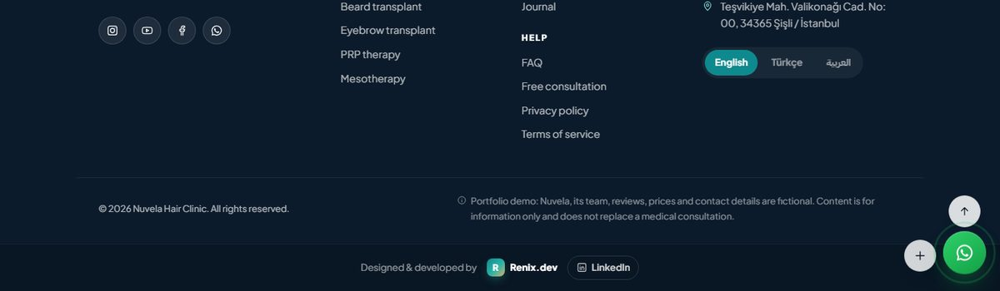

## License

MIT
